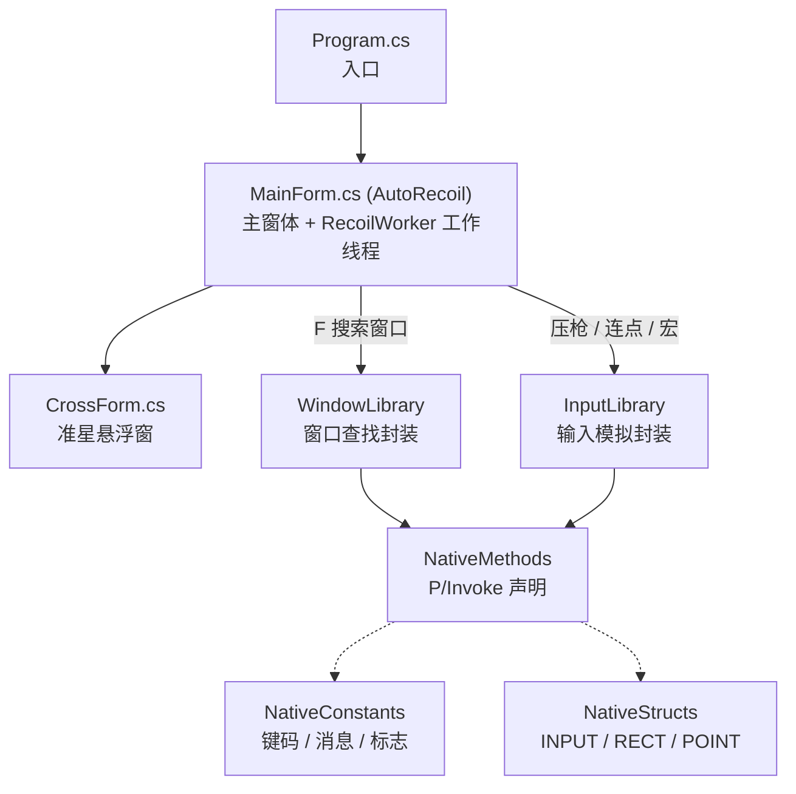
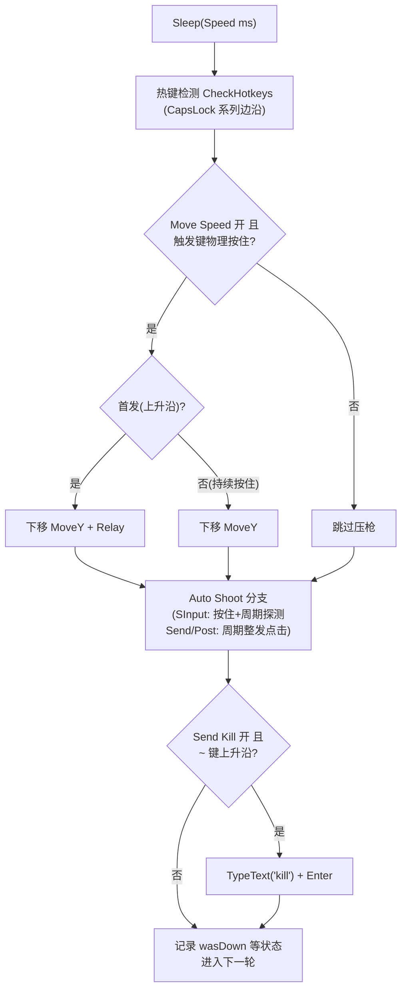

# 架构与实现原理

本文档面向想阅读、修改或扩展代码的开发者，说明 AutoRecoil 的模块划分、线程模型、输入注入原理与关键实现细节。使用方法见 [usage.md](usage.md)。

## 总体结构



各层职责：

| 层 | 文件 | 职责 |
| --- | --- | --- |
| 入口 | `Program.cs` | 启用视觉样式，运行主窗体 |
| UI | `Forms/MainForm.cs` | 控件事件、滑块同步、后台线程生命周期管理 |
| UI | `Forms/CrossForm.cs` | 128×128 无边框置顶窗，品红 TransparencyKey 透明底 + 红色 `*` |
| 业务 | `Libraries/InputLibrary.cs` | SendInput 移动 / 按键 / 打字、窗口消息点击、按键状态查询 |
| 业务 | `Libraries/WindowLibrary.cs` | EnumWindows 按标题查找窗口（线程安全、无 UI 依赖） |
| 互操作 | `Interop/NativeMethods.cs` | 仅 `DllImport` 原始声明 |
| 互操作 | `Interop/NativeConstants.cs` | 虚拟键码、窗口消息、输入标志常量 |
| 互操作 | `Interop/NativeStructs.cs` | `RECT` / `POINT` / `MOUSEINPUT` / `KEYBDINPUT` / `INPUT` |

## 线程模型

进程内共三类线程：

1. **UI 线程**：WinForms 消息循环。所有控件事件在此处理，只做一件事——把滑块/单选框/复选框的值写进共享字段。
2. **RecoilWorker 工作线程**（`MainForm.RecoilWorker`）：唯一的核心线程，主窗体加载时启动、`FormClosing` 时置 `_running = false` 并 `Join(500)`。循环体为：`Sleep(Speed)` → 检测热键 → 压枪 → 连点 → kill 宏。
3. **临时搜索线程**：点 F 按钮时创建，执行 `WindowLibrary.FindMainWindowByTitle`，完成后 `Invoke` 回 UI 线程更新句柄显示。

**UI 与工作线程的同步方式**：全部共享配置字段声明为 `volatile`（`_inputMode`、`_moveX`、`_autoShoot` 等），UI 线程写、工作线程读。由于都是单字段的"最新值覆盖"语义，无复合不变量需要保护，volatile 即足够；热键触发时通过 `Invoke` 回 UI 线程改复选框状态，再由复选框事件同步回共享字段。

**按键状态检测**：工作线程用 `GetAsyncKeyState` 轮询（高位为 1 = 按住），配合上一帧状态做上升/下降沿检测，避免按住期间重复触发。合成注入的事件同样会反映在 `GetAsyncKeyState` 中——这正是 Auto Shoot SInput 模式需要"探测技巧"的原因（见下文）。

## 三种输入注入方式对比

| | SendInput（SInput） | SendMessage | PostMessage |
| --- | --- | --- | --- |
| 通道 | 系统输入队列（合成物理事件） | 目标窗口消息队列（阻塞等处理完） | 目标窗口消息队列（投递即返回） |
| 生效范围 | 全局，前台程序与多数游戏 | 仅目标窗口 | 仅目标窗口 |
| Raw Input 游戏 | 能收到 | 忽略 | 忽略 |
| 是否需要窗口句柄 | 否 | 是 | 是 |
| 本项目中的用途 | 压枪移动、连点、kill 宏 | 连点（备选） | 连点（默认） |

关键代码位置：

- `InputLibrary.MoveMouseRelative`：`MOUSEEVENTF_MOVE` 相对移动。压枪恒走这条路（窗口消息方式对鼠标移动无效）
- `InputLibrary.SetMouseButton`：单次按下/抬起，SInput 连点用
- `InputLibrary.ClickMouseToWindow`：`WM_LBUTTONDOWN/UP` 或 `WM_RBUTTONDOWN/UP`（含 `MK_*` wParam），lParam 用当前光标坐标构造（低 16 位 X，高 16 位 Y），Send/Post 连点用
- `InputLibrary.TypeText`：`VkKeyScan` 把字符映射为 VK（含 Shift 状态位），以键盘事件序列注入。**不用** `KEYEVENTF_UNICODE`，因为 Unicode 字符事件会被多数 Raw Input 程序忽略，而 VK 注入等价真实按键
- `InputLibrary.KeyClick`：单键按下+抬起（kill 宏的回车用）

## 关键流程

### RecoilWorker 主循环



压枪位移（`PerformRecoil`）把本次总位移拆分为 `max(1, Shoot/10)` 步发送，余量并入第一步，让移动更平滑；`dx = MoveX - 10`，正为右、负为左。

### Auto Shoot 的"按住 + 周期探测"技巧（SInput 模式）

直接用合成事件"按住再抬起"做连点有个坑：**注入的按下事件也会让 `GetAsyncKeyState` 返回按住状态**，程序无法区分"物理按住"和"自己注入的按住"，导致用户松开后永远判定为按住。

本项目（SInput 模式）的实现：

1. 开始连发：注入一次"按下"，此后保持
2. 每经过 `Shoot` 毫秒：先注入"抬起"，立刻读 `GetAsyncKeyState` —— 此时读到的必然是物理状态
3. 仍按住 → 再注入"按下"（等于完成一次点击循环，继续连发）；已松开 → 停止

### 热键系统

`CheckHotkeys` 在工作线程中每轮轮询 CapsLock，按下沿触发（`_wasCapsDown` 记录上一帧），再查修饰键组合：

| 组合 | 动作 |
| --- | --- |
| CapsLock 单独 | 切换 Move Speed |
| Shift + CapsLock | 切换 Auto Shoot |
| Alt + CapsLock | 切换 Send Kill |
| 含 Ctrl 的任意组合 | 刻意忽略 |

切换动作不直接改共享字段，而是 `Invoke` 回 UI 线程翻转对应复选框的 `Checked`，由复选框自己的 `CheckedChanged` 事件统一同步到共享字段并更新文字颜色，保证界面与逻辑永远一致。

### 窗口查找（F 按钮）

`WindowLibrary.FindMainWindowByTitle` 用 `EnumWindows` 遍历顶层窗口，`GetWindowTextW` 取标题做忽略大小写的包含匹配，命中第一个即停止。整段逻辑无 UI 依赖，在临时后台线程中执行，避免长枚举卡 UI；结果经 `Invoke` 更新句柄标签（蓝色=成功，红色=failed!）并记录 `_targetHwnd` 供 C 按钮定位准星。

## 构建系统

### 一键构建脚本（build.cmd）

仓库根目录的 `build.cmd` 只依赖 **Windows 系统自带的 .NET Framework MSBuild**（`C:\Windows\Microsoft.NET\Framework64\v4.0.30319\MSBuild.exe`，所有装有 .NET 4.x 的机器都存在），不要求 Visual Studio / Build Tools / Developer Pack。查找顺序：

1. 系统自带 MSBuild（Framework64 → Framework，任选其一，编译结果与 MSBuild 进程位数无关）
2. 兜底：通过 vswhere 查找 Visual Studio 自带的 MSBuild
3. 都没有则报错退出

对每个 `x86 / x64 × Debug / Release` 组合执行一次编译，任何一路失败脚本以非零码退出：

```
msbuild autorecoil.csproj
  /p:Configuration=<Debug|Release>
  /p:Platform=<x86|x64>
  /p:PlatformTarget=<x86|x64>     # 真实 PE 头（I386 / AMD64），而非 AnyCPU
  /p:OutputPath=bin\<arch>\<cfg>\
  /p:IntermediateOutputPath=obj\<arch>\<cfg>\
  /p:FrameworkPathOverride=<系统运行时目录>
```

两个关键点：

- **不改工程文件的平台方案**：csproj 只定义了 AnyCPU 平台组。脚本用命令行全局属性覆盖（全局属性优先级高于工程文件内定义），因此 IDE 里的默认配置完全不受影响；`OutputPath` / `IntermediateOutputPath` 按架构分目录，避免两次构建互相污染增量输出。
- **FrameworkPathOverride**：`.NET Framework 4.x 的运行时安装不附带引用程序集（targeting pack）`，裸系统上直接编 `TargetFrameworkVersion=v4.8` 会报 MSB3644。该属性把 `{TargetFrameworkDirectory}` 指到运行时目录（`C:\Windows\...\v4.0.30319`，其中就是 4.8 版本的原位升级程序集），RAR 直接从这里解析 `System.Windows.Forms` 等引用。装有 Developer Pack 的机器上此覆盖同样无害。

产物：`autorecoil/bin/{x86,x64}/{Debug,Release}/autorecoil.exe`。注意 `.cmd` 批处理含中文时必须保存为 ANSI/GBK 编码（UTF-8 会被 cmd 按 GBK 拆字节解析导致整脚本错乱），仓库内的脚本已按此保存。

### IDE 构建

Visual Studio / SharpDevelop 打开 `autorecoil.sln` 按默认 AnyCPU 配置生成即可：x64 系统上以 64 位进程运行。`SendInput` / `GetAsyncKeyState` 与目标程序位数无关。

## 技术亮点：INPUT 结构在 x64 下的对齐问题

`Interop/NativeStructs.cs` 里有这个项目最值得记录的一个坑（注释已详述，此处展开）：

`INPUT` 结构是鼠标/键盘输入的共用 union。C# 中若用显式布局 `[FieldOffset(4)]` 直接平铺 union 成员（网上常见写法）：

- **x86**：联合体落在偏移 4，恰好正确
- **x64**：`MOUSEINPUT` 含 8 字节指针成员 `dwExtraInfo`，真实 Win64 `INPUT` 的联合体必须对齐到偏移 8（总大小 40 字节）。固定偏移 4 会让 `SendInput` 从错误偏移读取 `dx/dy` → **返回值 sent=1（注入"成功"）但光标纹丝不动**

本项目的解法：`INPUT` 用 `LayoutKind.Sequential` 顺序布局，只含 `type` + 嵌套的显式布局 `InputUnion` 结构体，让 marshaler 按当前进程位数自动对齐（x86=28 字节，x64=40 字节），双位数下均与原生定义一致。

调试同类问题时，`InputLibrary.MoveMouseRelative` 中前后各调一次 `GetCursorPos` 打到诊断日志，可直接确认"注入返回 1 但光标未动"这类症状。

## 诊断日志（TEMP-DIAG，发布前建议移除）

`InputLibrary.Diag` 是临时文件日志，把输入注入链路追加写入 exe 同目录的 `recoil-diag.log`（带锁、异常吞掉）。当前在以下位置打点：

- `MoveMouseRelative`：每次注入的 dx/dy、返回值、光标前后坐标
- `MainForm.RecoilWorker`：触发键状态变化、CapsLock 边沿时的修饰键状态
- `AutoRecoil_Load`：线程启动参数

所有打点均标注 `TEMP-DIAG` 注释。发布正式版时建议：删除 `Diag` 调用与 `_diagLastTrigger` / `_diagLastMoveSpeed` 字段，或把 `Diag` 方法体替换为空 / 包在 `#if DEBUG` 中——目前每次鼠标注入都有一次磁盘 IO，高频压枪下有可感知的开销。

## 已使用的 Win32 API 一览

| API | 用途 |
| --- | --- |
| `SendInput` | 合成鼠标移动/按键、键盘输入（压枪、连点、宏） |
| `GetAsyncKeyState` | 轮询物理按键状态（触发键、热键、~ 键） |
| `EnumWindows` | 按标题查找目标窗口 |
| `GetWindowTextW` / `GetWindowTextLengthW` | 读取窗口标题 |
| `GetWindowRect` | C 按钮定位准星到目标窗口中心 |
| `GetCursorPos` | 构造窗口消息点击的 lParam；移动前后诊断 |
| `PostMessage` / `SendMessage` | 向目标窗口投递鼠标点击 |
| `VkKeyScan` | 字符 → 虚拟键映射（TypeText） |

## 可能的扩展方向

- **配置持久化**：把滑块/开关状态序列化到 JSON/INI，启动时恢复
- **预设方案**：按武器保存多组 MoveY/RelayY 参数，热键切换
- **`RegisterHotKey`**：替换轮询式热键，避免与 CapsLock 原生功能冲突
- **Raw Input 监听**：用 `WM_INPUT` 替代 `GetAsyncKeyState` 轮询，降低延迟并精确区分物理/合成事件
- **准星窗口支持拖动与鼠标点击穿透（`WS_EX_TRANSPARENT` / `WS_EX_LAYERED`）**
- **移除 TEMP-DIAG 后改用结构化日志**（按需开关级别）
